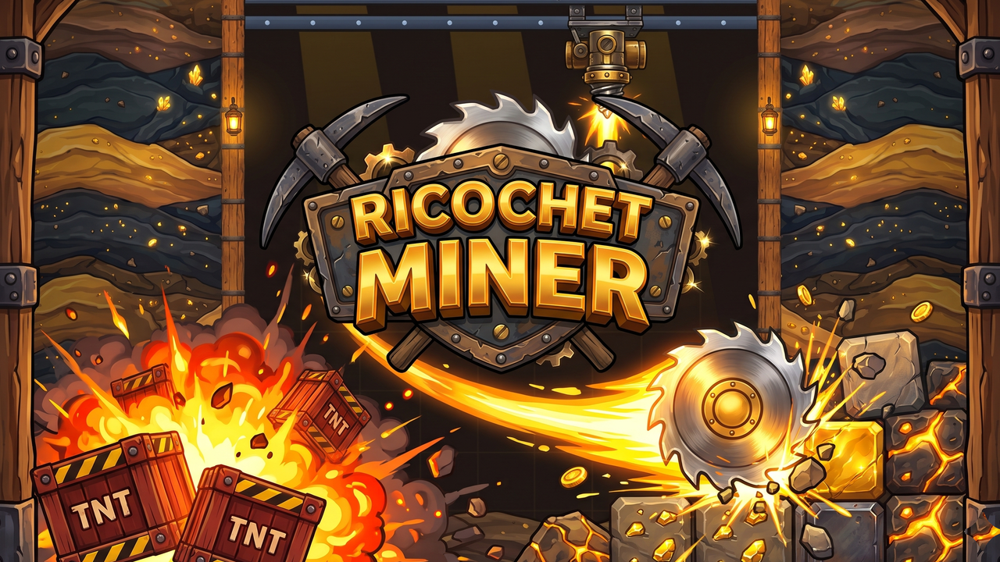
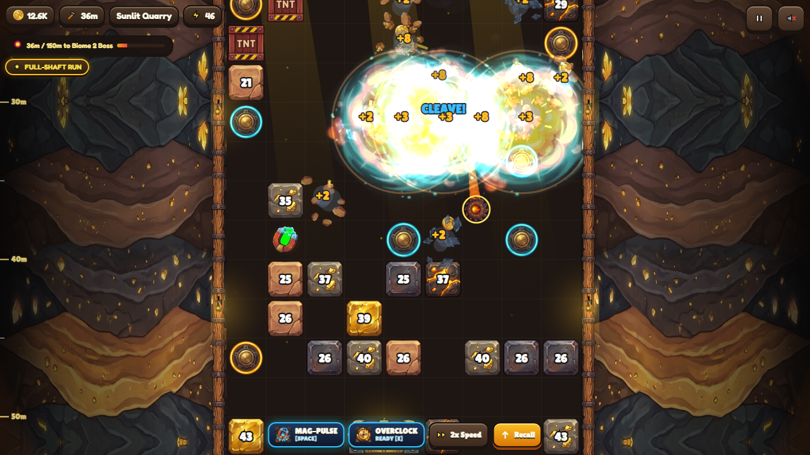
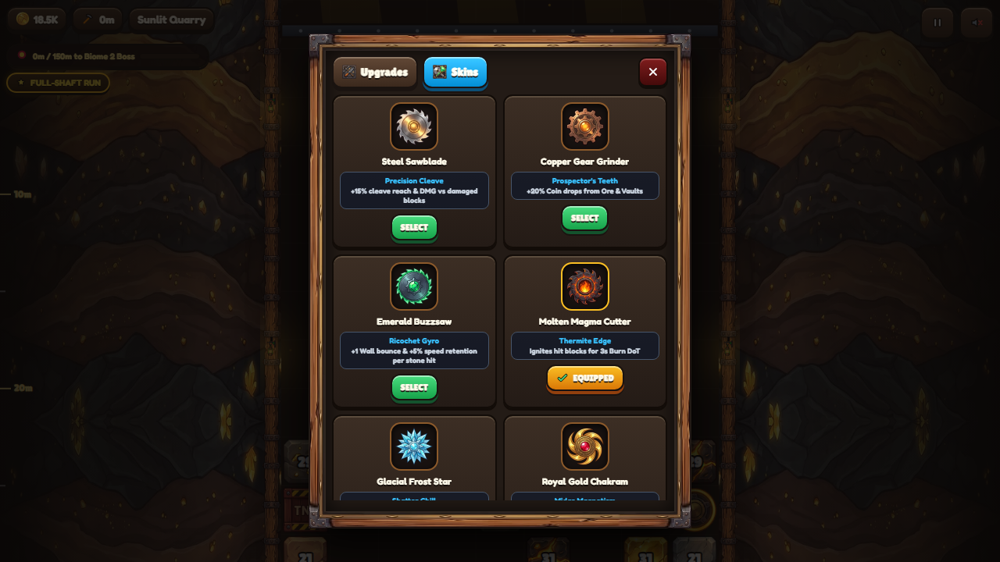
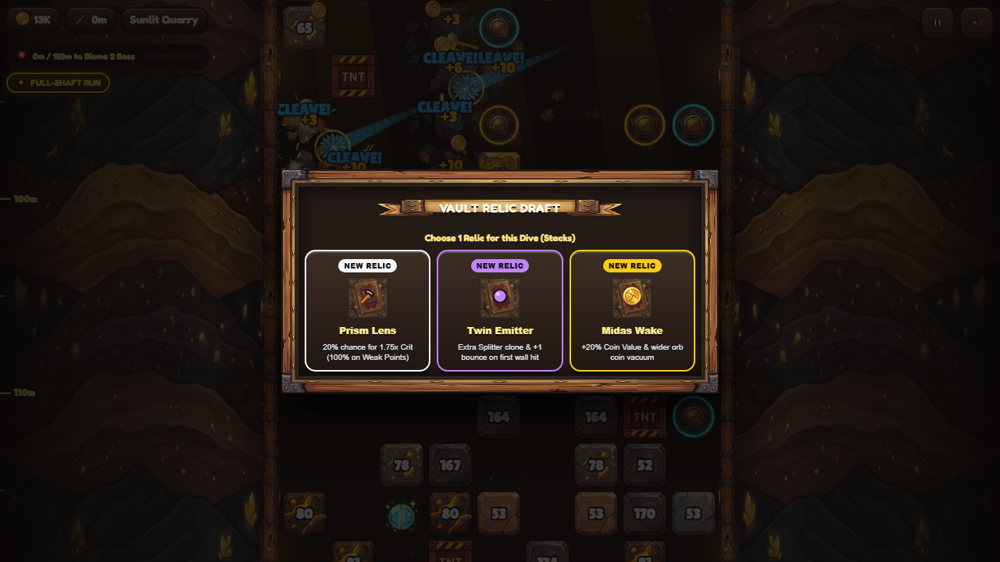
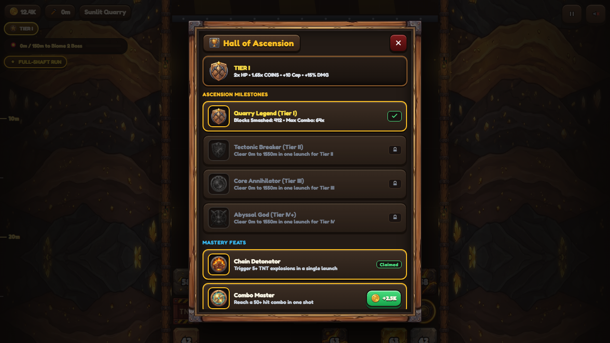
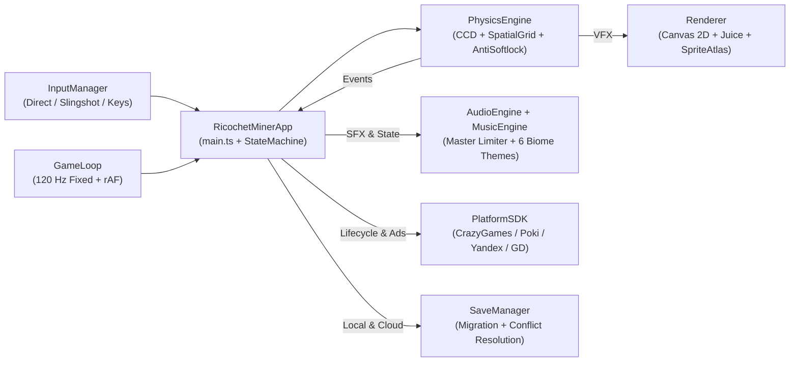

<div align="center">



# ⛏️ Ricochet Miner

**High-velocity physics-mining arcade roguelite built with zero runtime dependencies in TypeScript, HTML5 Canvas 2D, and Web Audio API.**

[](tsconfig.json)
[](vite.config.ts)
[](tests/)
[](package.json)
[](scripts/package-portals.mjs)
[](src/i18n/translations.ts)
[](src/sdk/PlatformSDK.ts)

<p>
  <a href="#-visual-showcase">Screenshots</a> •
  <a href="#-key-features">Key Features</a> •
  <a href="#-tech-stack--engineering-highlights">Engineering</a> •
  <a href="#-architecture">Architecture</a> •
  <a href="#-getting-started">Getting Started</a> •
  <a href="#-portal-builds--deployment">Portal Builds</a> •
  <a href="#-testing">Testing</a>
</p>

</div>

---

**Ricochet Miner** drops players into a 9-column vertical mine shaft spanning **6 underground biomes (`0m` to `1,550m+`)**. Aim a turret-mounted sawblade, chain physics-driven ricochets through TNT crates, pinball bumpers, laser blocks, and warp portals, draft stackable mid-run Relics, trigger active skills, and shatter Bedrock Boss Gates to ascend through scaling New Game+ Tiers.

Engineered from scratch with a **120 Hz fixed-timestep CCD physics engine**, **zero-allocation Spatial Grid**, **hybrid Web Audio DSP synthesizer + mastering pipeline**, and a **unified multi-portal SDK abstraction**, the entire production build ships in **~1.85 MB zipped** with **zero third-party runtime packages**.

---

## 📋 Table of Contents

- [📸 Visual Showcase](#-visual-showcase)
- [✨ Key Features](#-key-features)
- [🛠 Tech Stack & Engineering Highlights](#-tech-stack--engineering-highlights)
- [🏗 Architecture](#-architecture)
- [🚀 Getting Started](#-getting-started)
- [📜 Available Scripts & Asset Pipelines](#-available-scripts--asset-pipelines)
- [🧪 Testing](#-testing)
- [📦 Portal Builds & Deployment](#-portal-builds--deployment)
- [🔧 Troubleshooting](#-troubleshooting)

---

## 📸 Visual Showcase

<table>
  <tr>
    <td align="center" width="50%">
      
      <br />
      <strong>Chain-Reaction Ricochets &amp; Companion Drone</strong>
      <br />
      <sub>Multi-orb volleys, TNT shockwaves, Mag-Pulse Slam, and autonomous laser drone support.</sub>
    </td>
    <td align="center" width="50%">
      
      <br />
      <strong>9 Sawblade Skins &amp; Active Passives</strong>
      <br />
      <sub>Every blade modifies physics or damage behavior—from Thermite Burn DoT to Arc Lightning.</sub>
    </td>
  </tr>
  <tr>
    <td align="center" width="50%">
      
      <br />
      <strong>In-Run Vault &amp; Boss Relic Drafting</strong>
      <br />
      <sub>Crack 50m Vaults or Boss Gates to draft 1 of 10 stackable roguelite modifiers mid-dive.</sub>
    </td>
    <td align="center" width="50%">
      
      <br />
      <strong>Hall of Ascension &amp; Mastery Feats</strong>
      <br />
      <sub>Clear 0m → 1,550m in a single launch to unlock Tier I–IV+ scaling challenges.</sub>
    </td>
  </tr>
</table>

---

## ✨ Key Features

### Gameplay & Roguelite Loop
- **Precision Aiming & Cleave Physics:** Supports both **Direct Aim** (desktop hover/click + keyboard `A`/`D`/arrows) and **Slingshot Pull-Back** (mobile touch with cancel deadzone), backed by a real-time **2-bounce trajectory preview** (`computeTrajectoryPreview`). Orbs with `damage >= 2 × block.hp` cleave straight through weak blocks without spending bounce stamina.
- **Interactive Shaft Hazards & Power-Ups:** Sandstone, Slate, Granite armor, Gold/Molten Ore, sliding Frost blocks, chain-detonating **TNT Crates**, **Pinball Bumpers** (`+2` bounce stamina), **Row Laser Blocks**, **Splitter Prisms**, paired **Warp Portals**, and **Shaft Pickups** (`Split Gem`, `Magnet Coil`, `Overclock Battery`).
- **Active Combat Skills & Companion Drone:**
  - **Mag-Pulse Slam (`SPACE` / Tap):** Pulls loose coins, steers active orbs toward high-value targets, salvages falling Boss Shards, and blasts a localized kinetic shockwave.
  - **Overclock Spin (`E`):** Temporarily boosts orb speed (`1.25x`), damage (`1.55x`), and cleave reach; recharges every 20 blocks broken.
  - **Companion Auto-Drill Drone:** Unlocks automatically at `100m` depth or via Shop upgrade to snipe priority blocks and vacuum nearby coins.
- **Multi-Phase Bedrock Boss Gates:** Biome boundary gates guarded by indestructible `boss_armor` (splashing `20%` orb damage to the nearest core) and `3` `boss_core` targets with rotating `2.0x` **Weak-Point reticles** and **Phase 2 (`≤ 50% HP`) falling Boss Shards**.
- **9 Permanent Upgrades & Core Overclock Prestige:** Scale `Drill Damage`, `Max Bounces`, `Multi-Orb Volley`, `Orb Size & Blast`, `TNT & Bumper Luck`, `Ore Value`, `Companion Drone`, `Relic Forge`, and `Overclock Core`, plus Prestige reset (`+50%` permanent Damage & Coins/level).
- **Retention & Meta Progression:** 7-day login streak, rotating daily quests + Daily Mega Chest, offline Auto-Drill earnings (`15%` rate up to `4h`), Elevator biome checkpoints, 4 Mastery Feats, and 4 Ascension Milestones (`Tier I` to `Tier IV+`).
- **9-Language Localization:** Full UI & tutorial parity across **English (`en`)**, **Russian (`ru`)**, **Spanish (`es`)**, **Portuguese (`pt`)**, **French (`fr`)**, **German (`de`)**, **Turkish (`tr`)**, **Japanese (`ja`)**, and **Korean (`ko`)**.

<details>
<summary><strong>🗺️ Explore All 6 Underground Biomes, 9 Sawblade Passives &amp; 10 Vault Relics</strong></summary>

#### 6 Biomes (`0m` → `1,550m+`)
| Index | Biome | Depth Range | Coin Multiplier | Boss Gate |
| :---: | :--- | :---: | :---: | :--- |
| `0` | **Sunlit Quarry** | `0m – 150m` | `1.0x` | `150m` Bedrock Gate |
| `1` | **Crystal Caverns** | `150m – 350m` | `1.8x` | `350m` Bedrock Gate |
| `2` | **Magma Foundry** | `350m – 600m` | `3.1x` | `600m` Bedrock Gate |
| `3` | **Subzero Abyss** | `600m – 900m` | `5.4x` | `900m` Bedrock Gate |
| `4` | **Cyber Neon Vault** | `900m – 1,300m` | `9.2x` | `1,300m` Bedrock Gate |
| `5` | **Quantum Core** | `1,300m+` | `15.5x` (+`15%` / `250m`) | `1,550m` Final Ascension Gate |

#### 9 Sawblade Skins & Gameplay Passives
| Skin | Passive | Gameplay Effect | Unlock Condition |
| :--- | :--- | :--- | :--- |
| **Steel Sawblade** | *Precision Cleave* | `+15%` cleave reach & `+15%` DMG vs damaged blocks | Starter Blade |
| **Copper Gear Grinder** | *Prospector's Teeth* | `+20%` coin drops from Ore & Vaults | `450` Coins |
| **Emerald Buzzsaw** | *Ricochet Gyro* | `+1` bounce on first wall hit & `1.05x` wall speed retention | Break Quarry Boss Gate / `1,200` Coins |
| **Molten Magma Cutter** | *Thermite Edge* | Ignites hit blocks for `3.0s` Burn DoT (`22%` DPS) | Break Crystal Boss Gate / `4,500` Coins |
| **Glacial Frost Star** | *Shatter Chill* | `+25%` DMG vs Frost/Granite & `20%` chill splash on break | Break Magma Boss Gate / `15,000` Coins |
| **Royal Gold Chakram** | *Midas Magnetism* | `+40%` coin magnet radius & `+15%` Ore/Vault coins | Day 7 Streak / `45,000` Coins |
| **Tesla Plasma Rotor** | *Arc Discharge* | Every 5th bounce zaps nearby blocks (`55%` DMG) | `40`-Bounce Combo / `120,000` Coins |
| **Toxic Bio-Drill** | *Corrosive Splash* | `25%` AoE acid splash on break & `65%` Granite pierce | `350,000` Coins or `3` Rewarded Ads |
| **Obsidian Void Reaper** | *Phase Cleave* | `+35%` Boss Core DMG & zero speed loss on cleave | Reach Quantum Core / `1,000,000` Coins |

#### 10 Stackable Vault & Boss Relics
`Chain Fork` · `Volatile Gold` · `Twin Emitter` · `Kinetic Ramp` · `Siphon Edge` · `Blast Prism` · `Core Breaker` · `Midas Wake` · `Surge Battery` · `Prism Lens`

</details>

---

## 🛠 Tech Stack & Engineering Highlights

| Layer | Technology / Approach | Why It Matters |
| :--- | :--- | :--- |
| **Language & Build** | **TypeScript 5.7** (`strict: true`, `noUnusedLocals`), **Vite 6.0** (`ES2020` target) | Zero runtime framework overhead; tree-shaken single JS chunk + asset bundle under `~2.1 MB` unzipped. |
| **Rendering** | **HTML5 Canvas 2D** + DPR-aware `ViewportManager` (`1x–3x` scaling) | `ParticlePool`, `FloatingTextPool`, hit-stop freeze frames, screen shake, shockwaves, and `99+` WebP sprites. |
| **Physics & Collision** | **120 Hz Fixed Timestep** (`1/120s`) + **Swept CCD Sub-Stepping** | Sub-steps scaled by `max(2, radius * 0.35)` eliminate tunneling at `1,450 px/s`; `SpatialGrid` clears buckets in-place with zero per-frame allocations. |
| **Anti-Softlock** | **4-Layer Stall & Trap Watchdog** (`AntiSoftlock.ts`) | Ring-buffer Y-variance detection breaks horizontal loops & indestructible traps; `4.5s` stall triggers `2x` speed-up & overheat recall. |
| **Audio & DSP** | **Web Audio API** (`AudioEngine` + `MusicEngine`) | Brickwall safety limiter (`-1.5 dB`, `20:1`), priority `24`-voice stealing, pentatonic pitch climbing, `0`-leak static panners, dual-deck gapless looping, modal low-pass muffling, iOS Safari `'interrupted'` recovery, and Safari-safe `.wav`/`.mp3` `ffmpeg` pipeline. |
| **Portals & Persistence** | **Multi-Portal `IPortalAdapter`** + **`SaveManager`** | LocalStorage + Cloud conflict resolution (`totalCoinsEarned` / timestamp) with memory fallback for Incognito `SecurityError` / `QuotaExceededError`. |
| **Asset Pipelines** | **Sharp** (WebP chroma-keying) + **`ffmpeg-static`** (`loudnorm`) | Automated raw-to-production sprite slicing and `-16 LUFS` SFX / `-20 LUFS` BGM mastering. |

---

## 🏗 Architecture

### Runtime Pipeline



### Directory Structure

```text
Ricochet-Miner/
├── index.html                        # Entry shell (#game-canvas + #ui-root)
├── vite.config.ts                    # Vite config with per-portal SDK injection
├── tsconfig.json                     # Strict TypeScript compiler settings
├── package.json                      # Zero runtime deps; build, test, & asset scripts
├── scripts/
│   ├── process-assets.mjs            # Sharp chroma-key & WebP spritesheet slicer
│   ├── process-audio.mjs             # ffmpeg-static loudnorm -> Safari-safe .wav/.mp3
│   ├── generate-audio-sfx.py         # Prototype procedural numpy SFX generator
│   ├── package-portals.mjs           # Portal builds + automated QA audit + ZIP packer
│   ├── export-marketing.mjs          # Storefront cover & icon generator
│   └── capture-marketing.mjs         # Playwright marketing screenshot/video capture
├── src/
│   ├── main.ts                       # Application orchestrator & event wiring
│   ├── audio/
│   │   ├── AudioEngine.ts            # Master limiter, priority mixing, round-robin SFX, Safari recovery
│   │   └── MusicEngine.ts            # 6-biome adaptive synth + dual-deck crossfade BGM + modal filter
│   ├── config/
│   │   ├── gameConfig.ts             # Biomes, upgrades, skins, relics, balance formulas
│   │   └── adConfig.ts               # Ad grace period, cooldowns & RV placement thresholds
│   ├── core/
│   │   ├── GameLoop.ts               # 120 Hz fixed-step accumulator + 2x speed multiplier
│   │   ├── InputManager.ts           # Pointer capture, slingshot/direct aim, keyboard shortcuts
│   │   ├── StateMachine.ts           # BOOT / TITLE / AIMING / RUNNING / PERK_DRAFT / SHOP / AD_PAUSED
│   │   └── ViewportManager.ts        # Responsive portrait/desktop DPR scaling
│   ├── physics/
│   │   ├── PhysicsEngine.ts          # Swept CCD, cleave, TNT/laser/portal/drone/boss simulation
│   │   ├── SpatialGrid.ts            # Zero-GC grid partitioning & stamped queries
│   │   └── AntiSoftlock.ts           # Horizontal trap deflection & 4.5s stall watchdog
│   ├── rendering/
│   │   ├── Renderer.ts               # Canvas 2D world, turret, boss gate, & trajectory renderer
│   │   ├── SpriteAtlas.ts            # WebP asset preloader & thumbnail generator
│   │   ├── ParticlePool.ts           # Pooled sparks, rock chunks, smoke, & additive sprites
│   │   ├── FloatingTextPool.ts       # Pooled damage/coin/cleave popups
│   │   └── JuiceSystem.ts            # Hit-stop, camera shake, shockwaves, laser beams
│   ├── sdk/
│   │   ├── PlatformSDK.ts            # Portal lifecycle, muteAudio priority, ad state guard
│   │   ├── SaveManager.ts            # Schema migration, cloud merge, Incognito-safe storage
│   │   └── adapters/                 # CrazyGamesAdapter, PokiAdapter, YandexGamesAdapter, GameDistributionAdapter, MockAdapter
│   ├── systems/                      # Economy, Progression, Artifact, Retention, Skin, Monetization
│   ├── ui/                           # HUDController, ShopOverlay, PerkDraftModal, RetentionModals, Settings, Title, Ascension
│   ├── world/                        # ShaftGenerator (seeded chunk + boss gate builder) & Entities
│   └── i18n/translations.ts          # 9-language translation dictionary
├── tests/                            # 10 Vitest suites + 55-run autonomous playtest simulator
├── raw-assets/                       # Unprocessed artwork & spritesheets (excluded from dist/)
├── raw-audio/                        # Optional studio .wav/.mp3 overrides for audio:process
└── marketing-assets/ready/           # Storefront covers, icons, screenshots, and preview videos
```

---

## 🚀 Getting Started

### Prerequisites
- **Node.js 20+** (verified on Node `v26.13.0` / npm `11.20.0`)
- **npm** (included with Node.js)
- *Optional:* **Python 3** with `numpy` only if re-running legacy `scripts/generate-audio-sfx.py` (`scripts/process-audio.mjs` uses bundled `ffmpeg-static` directly)

### 1. Clone & Install

```bash
git clone https://github.com/psuvraneel-cyber/Ricochet-Miner.git
cd Ricochet-Miner
npm install
```

### 2. Start Development Server

```bash
npm run dev
```

Open **[http://localhost:5173](http://localhost:5173)** in your browser.

> **Tip — Local Testing Flags & Controls:**
> - **Aim & Launch:** Drag/release (`Slingshot Pull`) or hover/click (`Direct Aim`), or use `A` / `D` / `←` / `→` + `Space` / `Enter`.
> - **In-Run Skills:** `Space` (or canvas tap) triggers **Mag-Pulse Slam**; `E` triggers **Overclock Spin**.
> - **Shortcuts:** `M` toggles mute, `P` pauses, `1–6` quick-buys upgrades while Shop is open, `R` quick-relaunches from Run Summary.
> - **Dev QA Overlay:** In `development` / `mock` mode (`__DEV_MODE__ === true`), a dev panel is mounted for testing coins, biomes, and Ascension clears (strictly stripped from all production portal builds).
> - **Test CrazyGames Mute locally:** Append `?muteAudio=true` to the URL to verify platform-level audio mute priority.

---

## 📜 Available Scripts & Asset Pipelines

| Command | Description |
| :--- | :--- |
| `npm run dev` | Start Vite development server on port `5173` (`mock` portal mode). |
| `npm run typecheck` | Run strict TypeScript typechecking (`tsc --noEmit`). |
| `npm test` | Run all 10 Vitest unit, integration, compliance, and simulation test suites. |
| `npm run playtest` | Run the 55-run headless autonomous progression simulation (`tests/autonomous-playtest.test.ts`). |
| `npm run assets:process` | Slice & chroma-key `raw-assets/` spritesheets into compressed `.webp` assets in `src/assets/`. |
| `npm run audio:process` | Master `raw-audio/` (or fallback `.ogg`s) via `ffmpeg-static` into Safari-safe `.wav`/`.mp3` assets in `src/assets/audio/`. |
| `npm run build:crazygames` | Build & audit `dist/crazygames/` and package `release/ricochet-miner-crazygames.zip`. |
| `npm run build:poki` | Build & audit `dist/poki/` and package `release/ricochet-miner-poki.zip`. |
| `npm run build:gd` | Build & audit `dist/gamedistribution/` and package `release/ricochet-miner-gd.zip`. |
| `npm run build:yandex` | Build & audit `dist/yandex/` and package `release/ricochet-miner-yandex.zip`. |
| `npm run build:standalone` | Build & audit `dist/standalone/` and package `release/ricochet-miner-standalone.zip`. |
| `npm run build:all` | Build, audit, and ZIP all 5 portal distribution targets sequentially. |
| `npm run marketing:covers` | Export portal covers and square icons to `marketing-assets/ready/covers/`. |
| `npm run marketing:capture` | Capture storefront screenshots and videos from `dist/standalone/` via Playwright. |

### Studio Audio Mastering (`npm run audio:process`)
Drop studio `.wav`, `.mp3`, `.flac`, or `.m4a` files into `raw-audio/` (`sfx_*.wav` or `bgm_*.mp3`) and run `npm run audio:process`. `scripts/process-audio.mjs` automatically:
1. Trims leading/trailing silence (`silenceremove` at `-50 dB` / `-55 dB`).
2. Loudness-normalizes SFX to **`-16 LUFS` / `-1.0 dBTP`** and BGM to **`-20 LUFS` / `-1.5 dBTP`**.
3. Exports short impacts (`≤ 0.35s`) as **24 kHz 16-bit mono `.wav`** (zero encoder padding delay) and longer SFX / BGM tracks as **`.mp3`** (`160 kbps` SFX / `128 kbps` stereo BGM) for universal Chrome, Firefox, and iOS Safari decoding.
4. Supports automatic non-repeating **round-robin pools** when numbered variants (`sfx_hit_stone_1.wav`, `sfx_hit_stone_2.wav`, ...) are provided.

---

## 🧪 Testing

The project uses **Vitest** (`environment: 'node'`) with **10 test suites (54 tests)** covering deterministic physics, economy curves, audio DSP/SDK compliance, portal adapters, and full end-to-end progression:

```bash
# Run full test suite
npx vitest run

# Run typecheck + tests together
npm run typecheck && npx vitest run

# Run only audio & SDK compliance tests
npx vitest run tests/audio.test.ts tests/sdk-compliance.test.ts
```

<details>
<summary><strong>📊 Test Suite Breakdown (10 Files / 54 Tests)</strong></summary>

| Suite | Focus Area |
| :--- | :--- |
| [`tests/physics.test.ts`](tests/physics.test.ts) | CCD wall bounds, deterministic trajectories, cleave stamina retention, stall recall, horizontal trap deflection, boss armor splash, 2-bounce preview accuracy. |
| [`tests/stage2-mechanics.test.ts`](tests/stage2-mechanics.test.ts) | 9 blade passives, Mag-Pulse Slam, pickups, 10 Vault Relics, 2.0x Boss Weak-Point crit, Companion Drone, Burn DoT. |
| [`tests/ascension.test.ts`](tests/ascension.test.ts) | One-shot Biome 6 clears, Tier `I–IV+` scaling multipliers, Mastery Feats, Elevator clear gating. |
| [`tests/audio.test.ts`](tests/audio.test.ts) | Master brickwall limiter routing, CrazyGames `muteAudio` & `adStarted`, iOS `'interrupted'` recovery, zero `StereoPannerNode` leaks, priority throttling, kill dedup. |
| [`tests/sdk-compliance.test.ts`](tests/sdk-compliance.test.ts) | Re-entrant ad blocking, 3s init timeout fallback, Incognito `SecurityError` / `QuotaExceededError` save resilience, 100% 9-language key parity (zero emojis), banner throttling. |
| [`tests/autonomous-playtest.test.ts`](tests/autonomous-playtest.test.ts) | Headless 55-run simulation unlocking all 6 biomes (`0m` → `1,567m`), verifying SDK call balance & trajectory integrity. |
| [`tests/economy.test.ts`](tests/economy.test.ts) | Upgrade cost curves, prestige scaling, ore value multipliers, coin formatting. |
| [`tests/retention.test.ts`](tests/retention.test.ts) | Offline earnings caps, 7-day login streak progression, daily quest completion & Mega Chest. |
| [`tests/save.test.ts`](tests/save.test.ts) | Save serialization, v1 migration defaults, cloud vs. local conflict resolution. |
| [`tests/ftue.test.ts`](tests/ftue.test.ts) | Run-1 clear launch lane & guaranteed FTUE TNT + Gold cluster placement. |

</details>

---

## 📦 Portal Builds & Deployment

`scripts/package-portals.mjs` builds static production bundles via Vite (`base: './'`, `vite.config.ts`) and injects the target portal SDK script into `index.html`:

| Target | Command | Injected SDK / Adapter |
| :--- | :--- | :--- |
| **CrazyGames** | `npm run build:crazygames` | `crazygames-sdk-v3.js` → `CrazyGamesAdapter` (responsive banners, `muteAudio`, `adStarted`, cloud save, leaderboards) |
| **Poki** | `npm run build:poki` | `poki-sdk.js` → `PokiAdapter` (banners & adblock popups strictly disabled per Poki QA) |
| **Yandex Games** | `npm run build:yandex` | `yandex.ru/games/sdk/v2` → `YandexGamesAdapter` (server time, player cloud data, banner gating) |
| **GameDistribution** | `npm run build:gd` | `html5.api.gamedistribution.com/main.min.js` → `GameDistributionAdapter` |
| **Standalone / itch.io** | `npm run build:standalone` | `MockAdapter` (no external SDK scripts, ads cleanly disabled) |

Every portal build runs `auditDist()` automatically before generating `release/ricochet-miner-<portal>.zip`, enforcing:
- Root-level `index.html` with relative `./` asset paths (no `/assets/` root paths).
- Zero external font requests (`fonts.googleapis.com` forbidden), zero raw `.png`/`.jpg` reference leaks, and zero `DebugOverlay` code in production JS.
- Only allowlisted portal SDK URLs per target and strict **`< 20 MB`** size ceiling (current CrazyGames package: **~2.10 MB unzipped / ~1.85 MB zipped**).

---

## 🔧 Troubleshooting

<details>
<summary><strong>Common Setup & Build Questions</strong></summary>

- **Windows PowerShell command chaining:** Windows PowerShell 5.1 does not support `&&`. Run sequential commands on separate lines or with `; if ($LASTEXITCODE -eq 0) { ... }`.
- **No audio on first load / Safari mobile:** Browser autoplay policies suspend `AudioContext` until the first pointer/touch gesture. `AudioEngine.unlock()` initializes audio on the first drag, button click, or `touchend` (including post-call `'interrupted'` recovery on iOS).
- **`ffmpeg-static` missing during `npm run audio:process`:** Re-run `npm install` to restore the platform binary under `node_modules/ffmpeg-static/`.
- **Testing portal builds locally:** Serve `dist/<portal>/` via any static HTTP server (e.g., `npx vite preview --outDir dist/crazygames`) rather than opening `index.html` over `file://`, as ES modules and Web Audio `fetch()` require HTTP.

</details>
